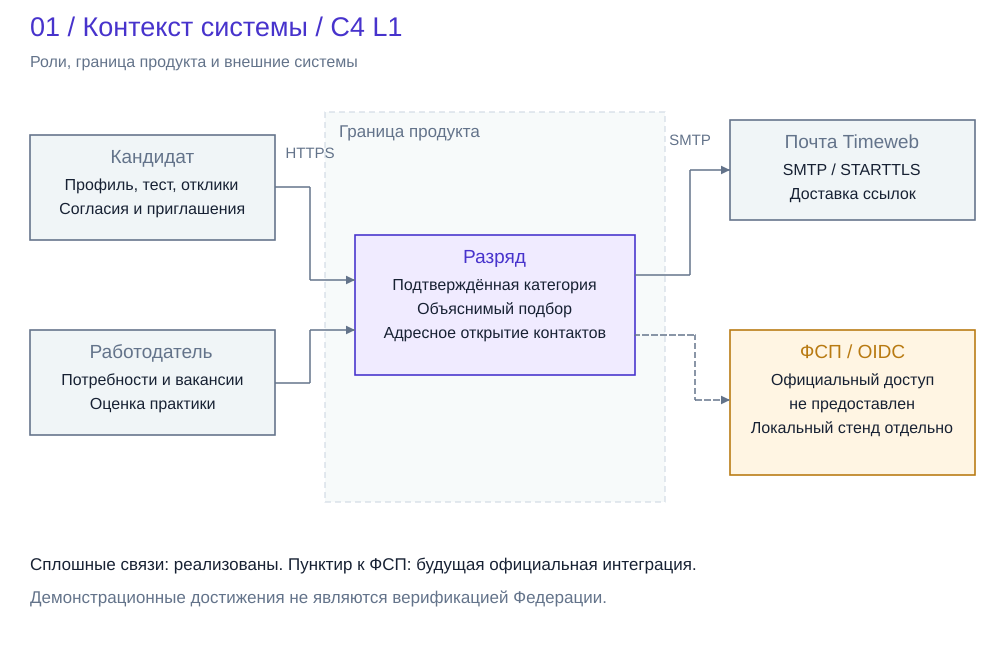
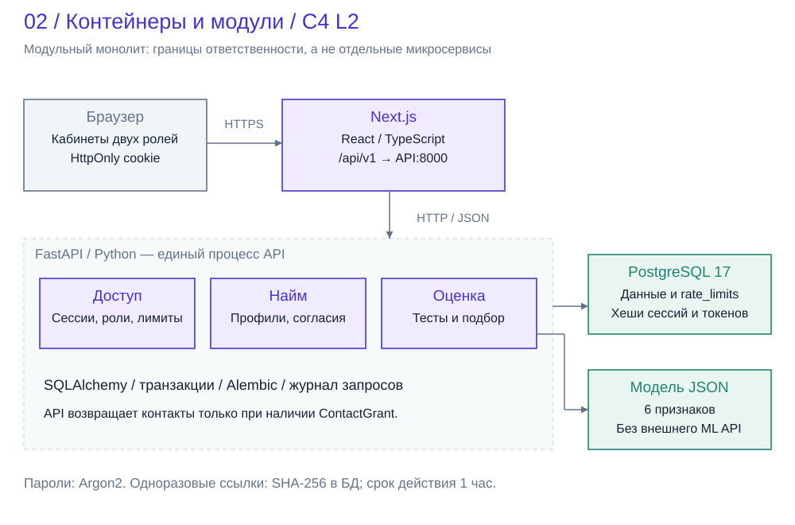
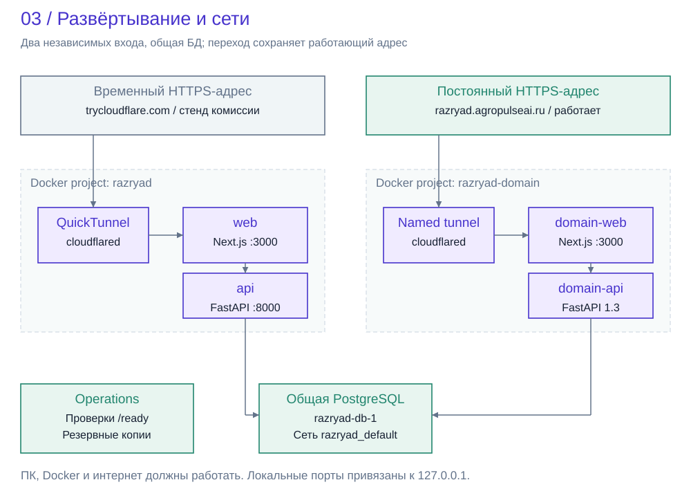
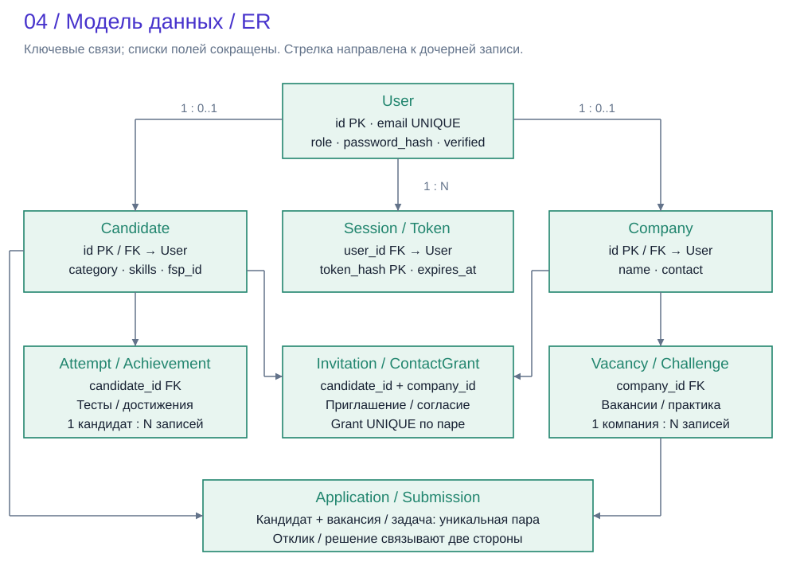
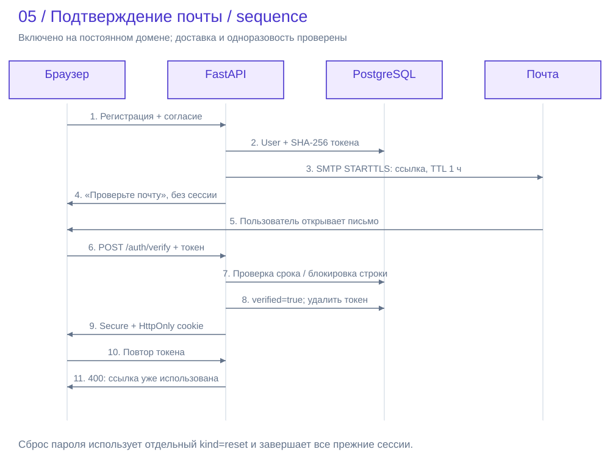
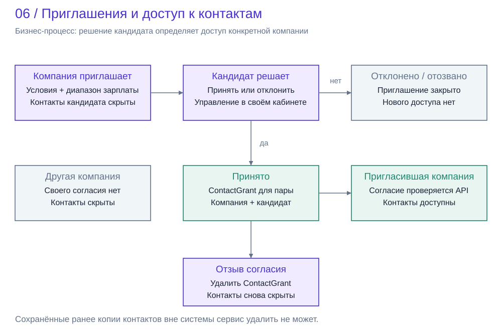
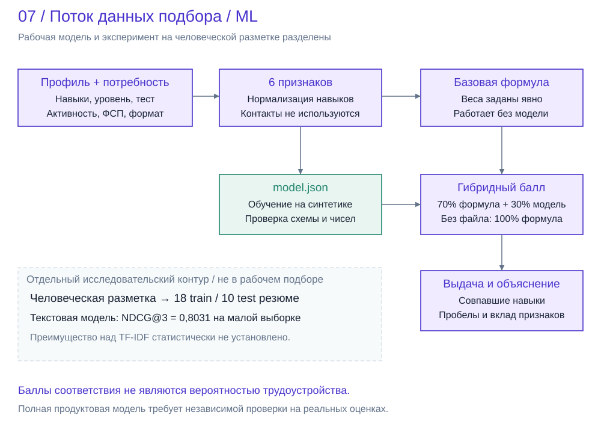
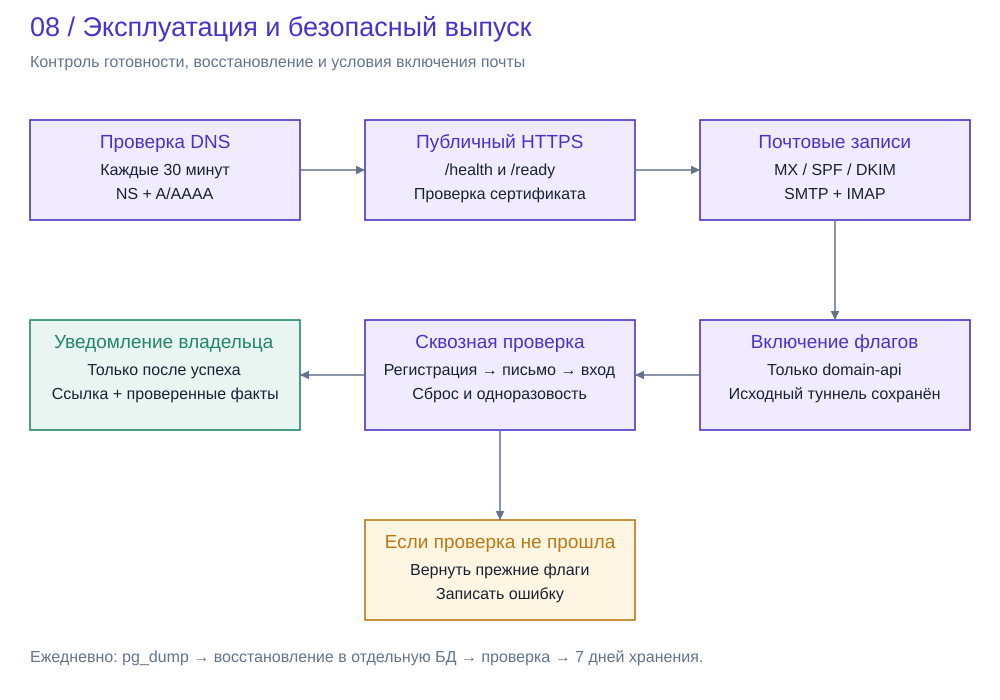

# Схемы архитектуры и ключевых процессов

Схемы описывают код и конфигурацию версии 1.3 на 11 октября 2026 года. Это
модульный монолит с отдельным frontend, PostgreSQL и внешними сервисами доставки
почты и публикации HTTPS. Границы модулей API не означают отдельных микросервисов.

Публичный временный стенд комиссии сохранён. Версия 1.3 развёрнута за постоянным
туннелем, но доступ по домену и включение обязательной почты зависят от DNS.
Официальный доступ к ФСП отсутствует; локальная OIDC-проверка не изображается
как подключение к Федерации. Исторические протоколы в предыдущих разделах
относятся к указанным в них версиям, а не заменяют проверки текущего выпуска.

## Контекст системы: пользователи и внешние зависимости

Кандидат контролирует публикацию профиля и адресные согласия. Работодатель
формулирует потребность и принимает решение о найме. Платформа помогает
сопоставить признаки, но не гарантирует трудоустройство и не присваивает
официальный спортивный разряд. Пунктир показывает будущую внешнюю интеграцию.

## Контейнеры и внутренние модули

Браузер обращается к Next.js по HTTPS; frontend проксирует API в Docker-сети.
FastAPI проверяет роль и владельца ресурса на сервере. PostgreSQL хранит
пользователей, результаты и согласия; SMTP отвечает за доставку одноразовых
ссылок. В рабочем подборе отсутствует зависимость от внешнего LLM API.

## Развёртывание без остановки стенда комиссии

Старый и доменный frontend имеют независимые API и сетевые псевдонимы.
Они используют общую PostgreSQL, поэтому миграции должны сохранять совместимость
с работающей версией. Именованный туннель сохраняет адрес при перезапусках,
но сам по себе не обеспечивает доступность выключенного ПК. Рабочие входы
не публикуют порт PostgreSQL в интернет. Ежедневное восстановление резервных
копий выполняется служебным процессом отдельно от пользовательских запросов.

## Данные и ограничения целостности

Диаграмма сокращает поля и группирует родственные таблицы, но не объединяет их
физически. Candidate и Company используют User.id как первичный и внешний ключ.
ContactGrant уникален для пары компания-кандидат. Отклик уникален для пары
кандидат-вакансия, решение практики - для пары кандидат-задача. Отдельно хранятся
Audit и RateLimit; полный контракт находится в backend/models.py и миграциях.

## Одноразовое подтверждение адреса

В БД сохраняется только хеш случайного токена. До подтверждения новый пользователь
не получает сессию. Проверка срока и потребление токена выполняются в транзакции
с блокировкой строки; повторное использование отклоняется. API публичного
стенда не раскрывает ссылку в JSON. Ошибка доставки не должна оставлять успешно
зарегистрированный аккаунт без ожидаемого письма. Сброс пароля использует другой
тип токена и отзывает существующие сессии.

## Обратный найм и адресное согласие

Согласие не является общей публикацией контактов. Проверка выполняется для
конкретной компании при формировании ответа API. Принятие приглашения или
отклик с адресным согласием могут создать доступ. Отзыв согласия закрывает
последующие ответы API, но не удаляет копии, ранее сохранённые получателем.

## Признаки, модель и исследовательский контур

В рабочей модели шесть признаков: навыки, тест, грейд, свежесть, достижения и
формат работы. При отсутствии или несовместимости JSON-модели используется
прозрачная формула. Внешний пилот на человеческой разметке оценивает отдельную
текстовую модель и не подтверждает качество всей продуктовой модели. Разбиение,
метрики, доверительный интервал и ограничения раскрыты в разделе 12.

## Эксплуатация и выпуск почтового подтверждения

Проверка DNS запускается локальной автоматизацией Codex каждые 30 минут.
Успех доставки SMTP не заменяет проверку получения письма. Перед включением
обязательной почты проверяются публичный HTTPS, DNS почты и полный пользовательский
сценарий. При ошибке возвращаются прежние флаги, старый стенд не перезапускается.
Автоматизация требует работающего ПК, Codex, Docker и сети.

## Воспроизводимость

Исходник схем: scripts/architecture_diagrams.py. Команда сборки SVG:
`python scripts/architecture_diagrams.py`. SVG хранятся в docs/assets/diagrams
и отображаются прямо в GitHub. Сборка документации: `python scripts/build-docs.py`.
В PDF сохраняется векторное качество; путь output/pdf/Разряд-документация.pdf
не меняется, поэтому ссылка уже отправленной заявки остаётся прежней.
